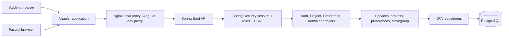
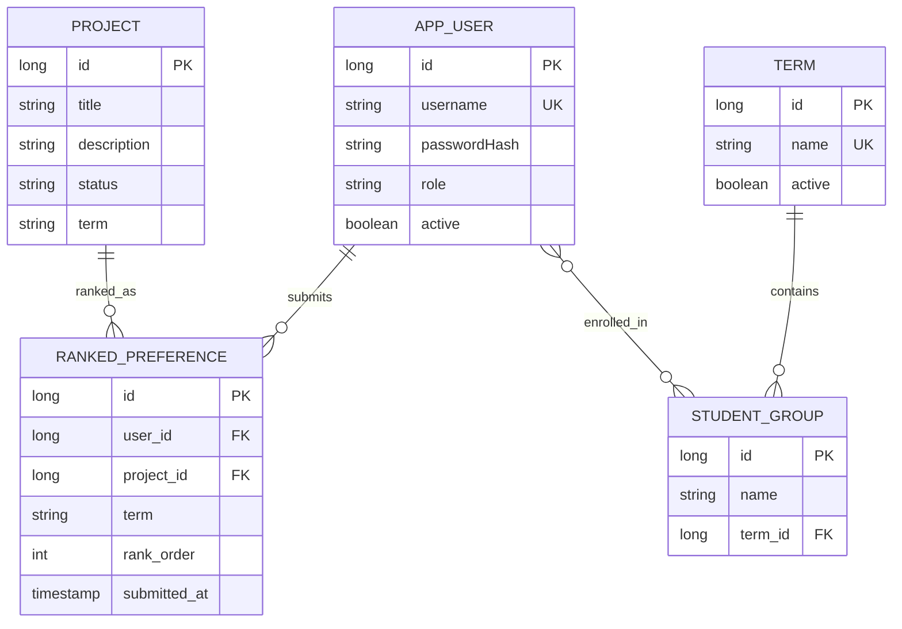

# Sprint 2 architecture and class responsibilities

## Entity model

*The `APP_USER` entity also retains a legacy non-deliverable email placeholder column solely for compatibility with the Sprint 1 schema. It is **not** used for login.*

## Request flow

1. Angular browser requests `GET /api/auth/csrf`, receives an anti-CSRF cookie, then signs in with a **portal username**.
2. Spring Security saves the user role and username in an HttpOnly session cookie.
3. Angular route guards improve navigation, but backend role restrictions are authoritative.
4. Student project catalogue only reads approved rows; project detail IDs are additionally validated against term and status.
5. Student preference controller obtains the session username (never trusts a client-provided user ID).
6. Faculty term/group endpoints are protected by `ROLE_FACULTY`.
7. JPA repositories persist changes in PostgreSQL; rankings are atomically replaced after validation.
