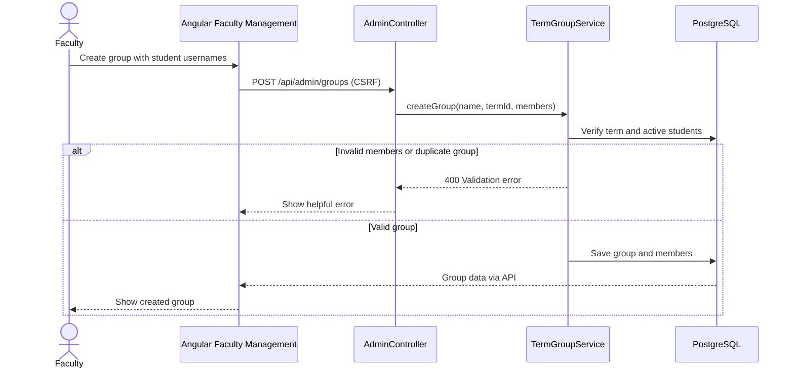

# US08 — Faculty Manage Terms and Groups

**Actor:** Faculty (portal-only account)

**User story:** As a faculty member, I want to manage teaching terms and organize student portal accounts into groups so that the Capstone process can be administered by term.

**Precondition:** Faculty is authenticated and has role FACULTY.

**Normal flow:**
1. Faculty opens dashboard, selects **Manage terms & groups**.
2. Faculty creates a named term or selects existing term.
3. Faculty may activate one term for student browsing and rankings.
4. Faculty enters a group name, selects a term and supplies comma-separated **existing portal student usernames**.
5. Backend validates terms, uniqueness and active student membership, then saves and displays the group.
6. Faculty may delete an obsolete group.

**Postcondition:** Term and group information is persisted. The active term is used by student screens.

**Edge cases:** Duplicate term; duplicate group name within a term; unknown member; faculty username used as a student member; duplicate member; missing term; unauthorized student calling faculty endpoint.

**Storyboard:** Faculty dashboard → Terms list and Add Term form → term selection → Group form with student usernames → group list with Delete actions.

**Code review:** `AdminController`, `TermGroupService`, `Term`, `StudentGroup`, `GroupRepository`, Angular `faculty-management` page.
