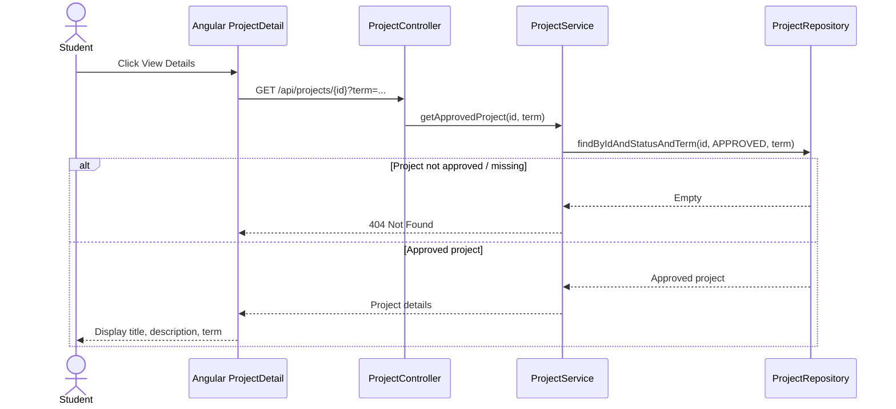

# US10 — View Approved Project Details

**Actor:** Student

**User story:** As a student, I want to open an approved project's details so I can determine whether to include it in my ranked preferences.

**Precondition:** Student logged in; project belongs to current term and is approved.

**Normal flow:** Student logs in → opens **Browse projects** → selects **View details** → sees project title, description, ID, status and term → can **Add to my preferences**.

**Postcondition:** Project details are displayed; optional navigation passes the project ID to the ranking screen without submitting it automatically.

**Edge cases:** Non-numeric or negative project ID; missing ID; draft, pending or wrong-term ID must not be exposed; unauthenticated or faculty requests are denied.

**Storyboard:** Approved project card [View details] → detail page [Title] [Status] [Term] [Description] [Add to my preferences] → ranking page.

**Code review:** `ProjectController`, `ProjectService`, `ProjectRepository`, `ProjectDetail`, `ProjectService` Angular.
